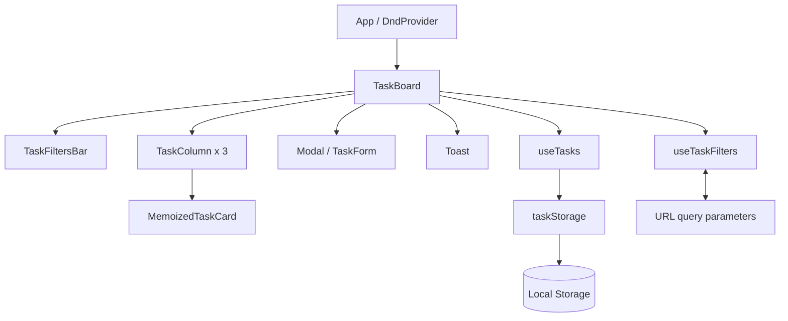
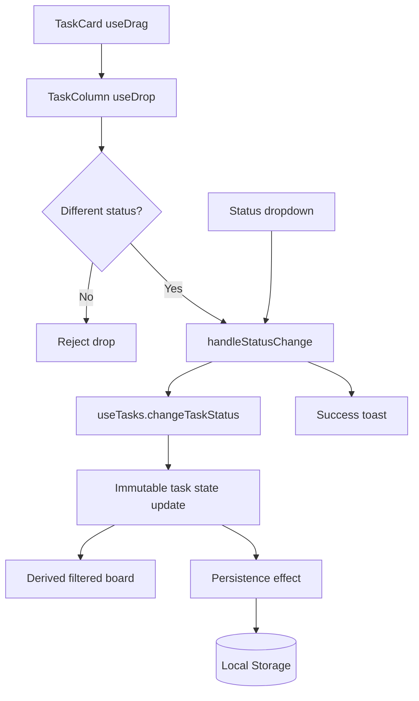

# Team Workflow Board — Architecture

## 1. Overview

The application is a client-side React and TypeScript workflow board. Its design separates presentation, transient drag interactions, task state, filter state and browser persistence. Task data has a single owner, and both drag-and-drop and dropdown interactions use the same status-update pathway.

## 2. Component architecture



| Module | Responsibility |
|---|---|
| App | Application shell and DndProvider with HTML5Backend |
| TaskBoard | Coordinates state, filtering, columns, forms and notifications |
| TaskColumn | Renders a workflow column and registers its drop target |
| TaskCard | Renders task details, controls and drag source |
| TaskForm | Collects and validates task input; reports dirty state |
| TaskFiltersBar | Presents search, filtering and sorting controls |
| useTasks | Owns task state, mutations and persistence lifecycle |
| useTaskFilters | Manages filter state and URL synchronization |
| taskStorage | Loads, validates, migrates and saves task data |
| taskDnd | Defines drag item type and payload contract |
| Shared UI | Reusable Button, Badge, Card, Modal and Toast components |

## 3. Domain model

```ts
export type TaskStatus = 'backlog' | 'in-progress' | 'done';
export type TaskPriority = 'low' | 'medium' | 'high';

export interface Task {
  id: string;
  title: string;
  description: string;
  status: TaskStatus;
  priority: TaskPriority;
  assignee: string;
  tags: string[];
  createdAt: string;
  updatedAt: string;
}

export type TaskInput = Pick<Task,
  'title' | 'description' | 'status' | 'priority' | 'assignee' | 'tags'
>;
```

IDs are generated using `crypto.randomUUID()`. Timestamps use ISO strings. TaskInput excludes system-managed IDs and timestamps. Creation initializes both timestamps; editing and actual status changes update `updatedAt`.

## 4. State management and data flow

`useTasks` owns the task collection. `TaskBoard` owns modal visibility, editing selection, form dirty state and success notifications. `useTaskFilters` manages search, selected statuses, priority and sort settings. React DnD owns transient drag and hover state, not persistent task data.

Task updates use functional state setters and immutable array transformations. Unchanged task objects retain their references. The board derives its visible tasks with `useMemo`, applying title/description search, status and priority filters, then sorting by priority or the selected timestamp. Each column receives only its matching tasks and an indicator of whether unfiltered tasks exist, allowing distinct empty-state messages.

## 5. Drag-and-drop architecture

`DndProvider` in App supplies the shared drag-and-drop manager. The HTML5 backend connects the manager to native browser drag events.

```ts
export const DND_ITEM_TYPES = { TASK: 'TASK' } as const;

export interface TaskDragItem {
  id: string;
  status: TaskStatus;
}
```

TaskCard uses `useDrag` with a dedicated span handle and a separate card preview wrapper. The monitor supplies `isDragging`, which controls opacity. TaskColumn uses `useDrop` at the component's top level, avoiding hook calls inside the board's mapping loop. It accepts TASK items and rejects drops whose source status equals its own status. The monitor supplies hover and eligibility state for destination styling.



The payload contains only the task ID and source status, reducing coupling. A valid drop calls the existing status callback. The task collection is updated centrally; column counts and card positions follow from the derived board. Cancelling a drag or dropping outside a valid target does not invoke the status update. Same-column drops do not trigger a success notification or timestamp change.

Active filters remain unchanged after movement. A task moved to an excluded status is hidden until the filters are adjusted. Sorting remains authoritative; drag-and-drop does not introduce manual ordering.

## 6. Persistence and migration

The storage utility encapsulates serialization, validation and version migration. The current schema is version 2, with support for migration from version 1. `useTasks` initializes state from `loadTasks(initialTasks)` using a lazy state initializer and saves changes through a `useEffect` dependent on the task collection and persistence eligibility.

- Valid saved tasks are restored, including an intentionally empty collection.
- Legacy supported data is migrated and a migration notice is displayed.
- Corrupted or unsupported saved data is handled through the storage error pathway.
- An initial load error disables automatic persistence for that mounted instance to avoid overwriting problematic saved data.
- Save errors are exposed as storage warnings.

Storage is scoped to the browser origin. It is not a database or multi-user synchronization mechanism.

## 7. Accessibility and UX

Workflow sections expose accessible names. Task status selects remain keyboard-operable and provide an alternative to pointer dragging. The drag handle is supplementary rather than the only means of changing status. Modal and form interactions retain their existing accessibility behavior and unsaved-change confirmation. Notifications and storage warnings communicate operation outcomes. Responsive layouts support narrow and wide screens.

## 8. Performance decisions

- `React.memo` wraps TaskCard to reduce re-renders caused by unchanged props.
- `useCallback` stabilizes edit and status callbacks passed to cards.
- Immutable updates preserve references for unchanged task objects.
- `useMemo` caches filtered and sorted results until tasks or filters change.
- Drag monitors collect only relevant interaction state and handler IDs used by tests.

Memoization does not prevent updates from a card's own hook subscriptions. Moving a card between columns can unmount and remount it. Filtering and sorting still run when their dependencies change; the board is not virtualized. No numerical performance benchmark is claimed.

## 9. Testing architecture

Production uses HTML5Backend; tests use React DnD TestBackend through `renderWithDnd`. The helper provides a DnD context and exposes the test backend. Handler IDs are obtained dynamically from monitor-generated DOM data attributes rather than hardcoded.

Tests simulate begin-drag, hover, drop and end-drag inside React Testing Library's `act`. Deterministic fixtures are saved using the real storage utility. Assertions verify accessible column membership, status controls, feedback classes, notifications and persisted data.

| Suite | Tests |
|---|---:|
| TaskBoard | 4 |
| Storage | 4 |
| Drag-and-drop integration | 12 |
| **Total** | **20** |

The integration tests exercise the real drag-and-drop hooks, not mocked replacements. They do not simulate native browser pointer behavior; 21 manual browser checks complement them. Type checking and production builds are separate verification gates.

## 10. Trade-offs and future extensions

The HTML5 backend keeps desktop interaction straightforward but does not provide dedicated touch or keyboard dragging. The status dropdown remains the alternative. Manual ordering is intentionally excluded to avoid conflicts with sorting. Browser-local storage simplifies the assessment but does not support shared collaboration, server-side authorization or cross-device synchronization. Future extensions could include a touch-capable backend, explicit ordering rules, server persistence and browser end-to-end tests.
