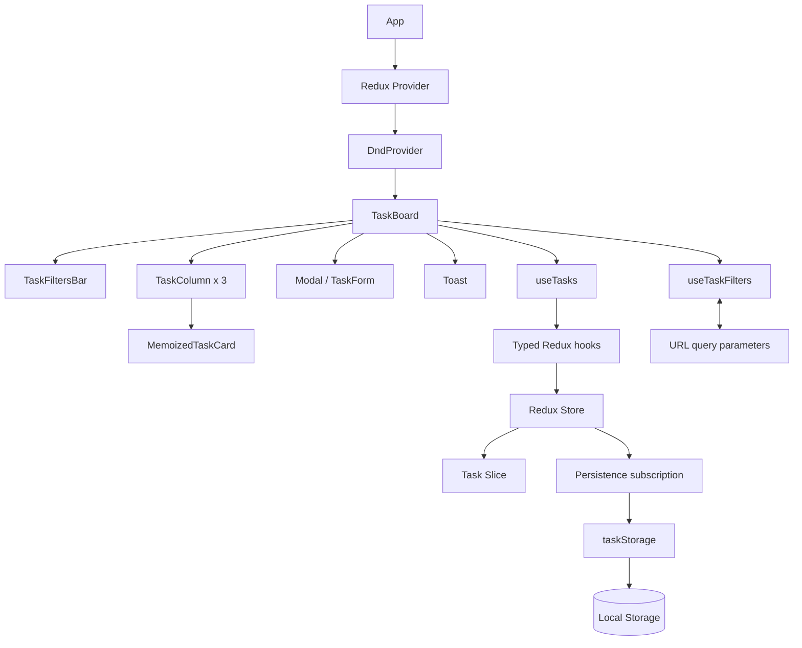
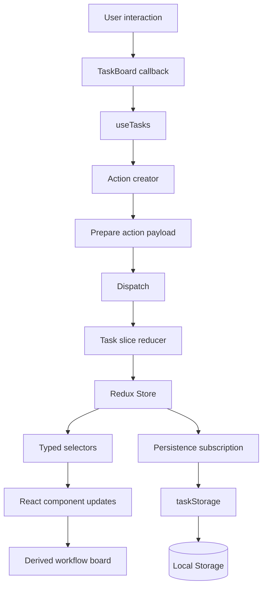
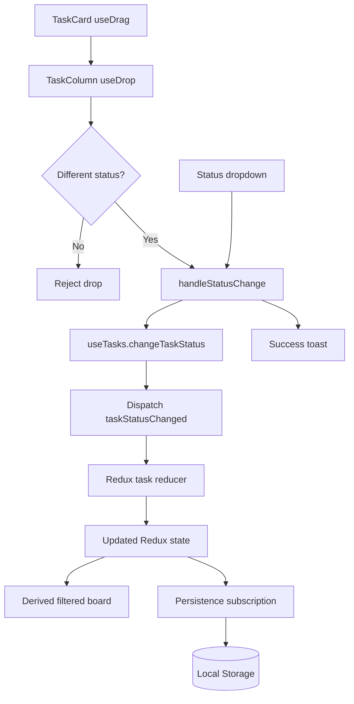
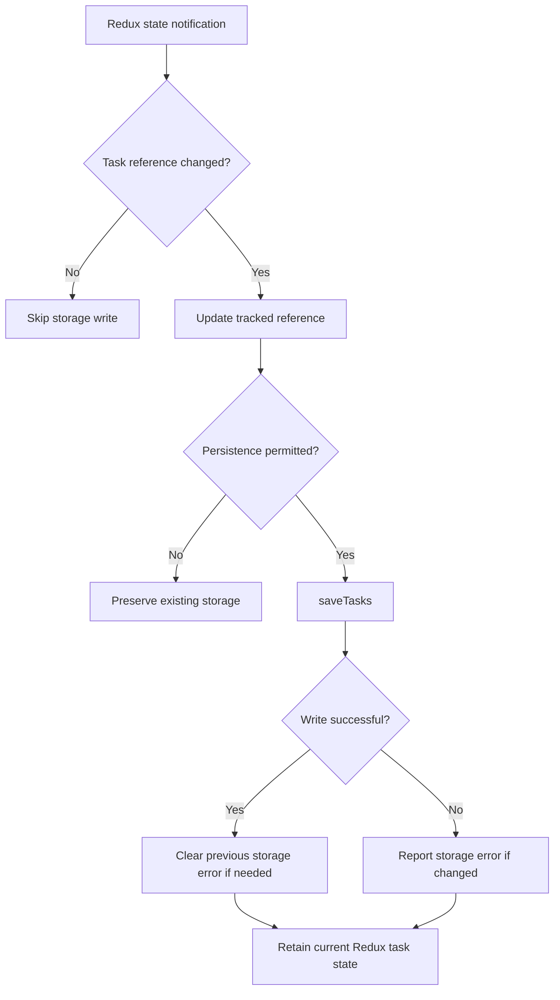

# Team Workflow Board — Architecture

## 1. Overview

The application is a client-side workflow board built with React, TypeScript, Redux Toolkit, and React DnD.

The architecture separates presentation, centralized task state, transient drag interactions, filter state, and browser persistence.

Redux Toolkit provides the single source of truth for task data. Both drag-and-drop and dropdown interactions use the same centralized status-update pathway.

The primary architectural objectives are:

- Predictable state transitions.
- Separation of concerns.
- Reusable presentation components.
- Type-safe interfaces.
- Immutable state updates.
- Reliable browser persistence.
- Accessible interaction alternatives.
- Testable business logic.
- Reduced unnecessary rendering and storage operations.

## 2. Component Architecture



| Module | Responsibility |
|---|---|
| App | Application shell, Redux Provider, and DndProvider |
| TaskBoard | Coordinates state, filtering, columns, forms, and notifications |
| TaskColumn | Renders a workflow column and registers its drop target |
| TaskCard | Renders task details, controls, and drag source |
| TaskForm | Collects and validates task input; reports dirty state |
| TaskFiltersBar | Presents search, filtering, and sorting controls |
| useTasks | Exposes selected Redux state and dispatch-backed task operations |
| useTaskFilters | Manages filter state and URL synchronization |
| taskSlice | Defines task state, reducers, and action creators |
| taskSelectors | Encapsulates Redux state selection |
| store | Creates configured Redux store instances and inferred types |
| appStore | Creates the application store and initializes persistence |
| store/hooks | Provides strongly typed React Redux hooks |
| taskPersistence | Synchronizes changed task data with browser storage |
| taskStorage | Loads, validates, migrates, and saves task data |
| taskDnd | Defines drag item type and payload contract |
| Shared UI | Reusable presentation and interaction components |

## 3. Domain Model

```ts
export type TaskStatus =
  'backlog' | 'in-progress' | 'done';

export type TaskPriority =
  'low' | 'medium' | 'high';

export interface Task {
  id: string;
  title: string;
  description: string;
  status: TaskStatus;
  priority: TaskPriority;
  assignee: string;
  tags: string[];
  createdAt: string;
  updatedAt: string;
}

export type TaskInput = Pick<
  Task,
  'title'
  | 'description'
  | 'status'
  | 'priority'
  | 'assignee'
  | 'tags'
>;
```

IDs are generated using `crypto.randomUUID()`.

Timestamps use ISO strings. `TaskInput` excludes system-managed IDs and timestamps.

Creation initializes both timestamps. Editing and actual status changes update `updatedAt` while preserving `createdAt`.

IDs and timestamps are generated in Redux action prepare callbacks rather than inside reducers.

## 4. Centralized State Management

### 4.1 State Ownership

The application distinguishes persistent domain state from temporary interaction state.

| State | Owner |
|---|---|
| Task collection | Redux task slice |
| Storage errors | Redux task slice |
| Migration notice | Redux task slice |
| Persistence eligibility | Redux task slice |
| Modal visibility | TaskBoard local state |
| Editing selection | TaskBoard local state |
| Form input and dirty state | React component state |
| Success notifications | TaskBoard local state |
| Search, filters, and sorting | useTaskFilters |
| Dragging and hovering | React DnD |

Only shared task-related state is centralized in Redux.

Temporary interaction state remains local where application-wide access is unnecessary.

### 4.2 Redux State Structure

```ts
export interface TasksState {
  tasks: Task[];
  storageError: string | null;
  migrationNotice: boolean;
  canPersist: boolean;
}
```

The task slice is registered under the `tasks` key in the root store.

The resulting state structure is:

```ts
{
  tasks: {
    tasks: [],
    storageError: null,
    migrationNotice: false,
    canPersist: true
  }
}
```

The actual initial state is populated from browser storage or the default task dataset.

### 4.3 Store Configuration

The store is configured using Redux Toolkit's `configureStore`.

The `createAppStore` factory supports optional preloaded task state.

When no explicit state is supplied, the factory calls `loadTasks(initialTasks)` and converts the result into the Redux task slice state.

The factory provides:

- Centralized reducer registration.
- Redux Toolkit default middleware.
- Development-time immutability and serializability checks.
- Redux DevTools integration.
- Independent store instances for automated tests.

The application store is created separately in `appStore.ts`.

This separation allows tests to import the store factory without automatically initializing the production store.

### 4.4 Typed Redux Hooks

The store exports inferred TypeScript types:

```ts
export type AppStore =
  ReturnType<typeof createAppStore>;

export type RootState =
  ReturnType<AppStore['getState']>;

export type AppDispatch =
  AppStore['dispatch'];
```

React Redux hooks are specialized using these types:

- `useAppDispatch`
- `useAppSelector`
- `useAppStore`

This provides type-safe state access and action dispatching without repeating store types throughout the application.

### 4.5 Task Slice and Actions

The task slice is implemented using Redux Toolkit's `createSlice`.

| Action | Responsibility |
|---|---|
| taskCreated | Insert a new task |
| taskUpdated | Update an existing task |
| taskStatusChanged | Change task status and modification timestamp |
| migrationNoticeDismissed | Clear the migration notice |
| storageErrorChanged | Set or clear the storage error |

Action prepare callbacks generate IDs and timestamps before reducer execution.

Reducers do not access browser storage, generate random IDs, or read the system clock.

This keeps reducer behavior deterministic for a given previous state and action.

### 4.6 Immutable Updates and Structural Sharing

Redux Toolkit uses Immer internally.

Reducers use mutation-style syntax against Immer drafts while producing immutable next-state objects.

For example, a status update modifies only the matching task.

Unchanged task objects retain their references.

Status updates for nonexistent tasks or tasks already in the requested status return without modifying state.

This supports:

- Predictable state transitions.
- Reference-based change detection.
- Stable selector results.
- React component memoization.
- Avoidance of redundant persistence operations.

### 4.7 Selectors

The selector module provides:

- `selectTasks`
- `selectStorageError`
- `selectMigrationNotice`
- `selectCanPersist`

Selectors encapsulate the internal Redux state structure.

Simple property-access selectors return existing references instead of creating new arrays or objects.

Memoized Redux selectors are not required for these direct lookups. Derived filtering and sorting remain handled by the existing filter and board logic.

### 4.8 UI Integration

The `useTasks` custom hook provides the interface between React components and Redux.

It subscribes to selected Redux state and exposes stable callbacks that dispatch task actions.

The public hook interface includes:

- tasks
- storageError
- migrationNotice
- dismissMigrationNotice
- createTask
- updateTask
- changeTaskStatus

Retaining this interface allows UI components to remain independent of the internal Redux implementation.

## 5. Application Data Flow

The application follows unidirectional state flow.



The Redux store owns the canonical task collection.

The workflow board derives its visible tasks from that collection using search, selected statuses, priority, and sorting settings.

Each column receives only its matching tasks and an indicator of whether unfiltered tasks exist, allowing distinct empty-state messages.

Derived board data is not duplicated in Redux.

## 6. Drag-and-Drop Architecture

### 6.1 Provider and Backend

`DndProvider` supplies the shared drag-and-drop manager.

The HTML5 backend connects the manager to native browser drag events.

The Redux Provider wraps the application and makes centralized state accessible to descendant components.

React DnD manages transient drag state, while Redux manages persistent task state.

### 6.2 Drag Item Contract

```ts
export const DND_ITEM_TYPES = {
  TASK: 'TASK',
} as const;

export interface TaskDragItem {
  id: string;
  status: TaskStatus;
}
```

The payload contains only the task ID and source status, reducing coupling between drag interactions and the complete task domain model.

### 6.3 Drag Source

TaskCard uses `useDrag` with:

- A dedicated span drag handle.
- A separate card preview wrapper.
- A typed drag item.
- Monitor-generated dragging state.
- Handler IDs used by automated tests.

The `isDragging` monitor value controls card opacity.

Dedicated drag handles prevent drag interactions from interfering with card buttons and status controls.

### 6.4 Drop Target

TaskColumn uses `useDrop` at the component's top level, avoiding hook calls inside the board's mapping loop.

Each column accepts TASK items and rejects drops whose source status equals its own status.

The monitor supplies hover and eligibility state for destination styling.

### 6.5 Shared Status-Update Pathway



A valid drop invokes the existing status callback.

The callback dispatches a Redux action through `useTasks`.

The reducer updates the task status and modification timestamp. Column counts and card positions follow from the derived board.

Cancelling a drag or dropping outside a valid target does not invoke the status update.

Same-column drops do not trigger a success notification or timestamp change.

Active filters remain unchanged after movement.

A task moved to an excluded status is hidden until the filters are adjusted.

Sorting remains authoritative; drag-and-drop does not introduce manual ordering.

## 7. Persistence and Migration

### 7.1 Storage Schema

The storage utility encapsulates serialization, validation, and version migration.

Storage key:

```text
everquint-workflow-tasks
```

Current schema version:

```ts
export const SCHEMA_VERSION = 2;
```

The persisted data contains the schema version and task collection.

```ts
interface StoredTasksV2 {
  schemaVersion: 2;
  tasks: Task[];
}
```

Transient UI state and Redux storage metadata are not persisted as part of the task payload.

### 7.2 Store Initialization

The store factory initializes task state through `loadTasks(initialTasks)`.

| Storage Condition | Initialization Behavior |
|---|---|
| Missing storage key | Load default tasks |
| Valid version 2 data | Restore saved tasks |
| Valid empty task collection | Preserve the empty board |
| Supported version 1 data | Migrate tasks and display a migration notice |
| Corrupted JSON | Load fallback tasks and report an error |
| Unsupported schema version | Load fallback tasks and report an error |

An initial load error sets `canPersist` to false.

This prevents the application from automatically overwriting problematic saved data.

### 7.3 Redux Persistence Subscription

Persistence is implemented outside reducers and React components using `store.subscribe()`.

The subscription tracks the previous task array reference.

After a Redux action is processed, the subscription compares the current task array reference against the previous reference.

If the reference has not changed, persistence is skipped.

If task data has changed and persistence is permitted, the subscription calls `saveTasks`.

Initial persistence also runs when the subscription is initialized, allowing default or migrated tasks to be written using the current schema.

### 7.4 Persistence Data Flow



The tracked reference is updated before persistence occurs.

This is important because reporting a storage error dispatches another Redux action.

Updating the reference first ensures that the nested notification does not trigger another unnecessary storage write.

### 7.5 Storage Failure Handling

If a storage write fails:

- The current Redux task state remains available in memory.
- The storage error is exposed to the UI.
- Subsequent task modifications attempt persistence again.
- A successful later write clears the previous storage error.

If the browser is refreshed before a successful save, unsaved in-memory changes can be lost.

An initial storage read failure is handled differently: automatic persistence remains disabled for that store instance to protect existing stored data.

### 7.6 Subscription Lifecycle

`setupTaskPersistence` returns an unsubscribe function.

The application store registers cleanup for Vite hot module replacement.

Automated tests explicitly unsubscribe from persistence listeners during cleanup.

Browser storage is scoped to the application origin. It is not a database, authorization mechanism, or multi-user synchronization service.

## 8. Filtering, Sorting, and URL Synchronization

The `useTaskFilters` hook manages:

- Search text.
- Selected workflow statuses.
- Priority filtering.
- Sorting field.
- Sorting direction.

Filter and sorting selections are synchronized with URL query parameters.

The board derives visible tasks by applying title and description search, status filtering, priority filtering, and sorting.

Sorting supports priority, creation date, and modification date.

Derived results are memoized using `useMemo`.

The filtered task collection is not stored separately in Redux, avoiding duplicated state and synchronization problems.

## 9. Accessibility and User Experience

Workflow sections expose accessible names.

Task status selects remain keyboard-operable and provide an alternative to pointer dragging.

The drag handle is supplementary rather than the only means of changing status.

Modal and form interactions retain their existing accessibility behavior and unsaved-change confirmation.

Validation messages, notifications, migration notices, and storage warnings communicate operation outcomes.

Responsive layouts support narrow and wide screens.

Dedicated keyboard dragging and comprehensive accessibility compliance are not claimed.

## 10. Performance Decisions

### 10.1 Component Memoization

`React.memo` wraps TaskCard to reduce re-renders caused by unchanged props.

`useCallback` stabilizes task edit and status callbacks passed to cards.

### 10.2 Immutable State Updates

Immer preserves references for unchanged task objects.

This allows memoized components to benefit from shallow prop comparisons.

### 10.3 Selective Redux Subscriptions

Typed selectors retrieve specific Redux state values.

Simple selectors return existing references instead of allocating new objects unnecessarily.

### 10.4 Derived State

`useMemo` caches filtered and sorted results until their dependencies change.

### 10.5 Persistence Optimization

The persistence subscription uses task array reference equality to avoid unnecessary browser storage writes.

Actions that only dismiss notices or update storage errors do not trigger additional task persistence.

### 10.6 Drag Monitor Subscriptions

Drag monitors collect relevant interaction state and handler IDs used by tests.

### 10.7 Performance Limitations

Memoization does not prevent updates from a component's own hook subscriptions.

Moving a card between columns can unmount and remount it.

Filtering and sorting still execute when their dependencies change.

The board is not virtualized.

Earlier React DevTools profiling demonstrated reduced unnecessary TaskCard rendering for a selected task update.

Redux reducer tests verify reference preservation after the state management migration.

No numerical speedup benchmark is claimed.

## 11. Testing Architecture

### 11.1 Testing Tools

- Vitest
- React Testing Library
- jsdom
- React DnD TestBackend
- Redux Toolkit store factory
- Real browser storage utility in the test environment

### 11.2 Reducer Unit Tests

Reducer tests invoke the task reducer directly with previous state and actions.

They verify state transitions, task creation, editing, status changes, timestamps, no-op behavior, immutability, structural sharing, migration notice dismissal, and storage error updates.

Reducers can be tested without mounting React components.

### 11.3 Selector Unit Tests

Selector tests verify that the expected Redux state values are returned.

Reference equality assertions protect against unnecessary array allocation when unrelated state changes.

### 11.4 Store and Persistence Integration Tests

Store integration tests create independent Redux stores using `createAppStore`.

They verify:

- Default and preloaded state initialization.
- Store isolation.
- Initial persistence.
- Persistence after task creation and status changes.
- Avoidance of unnecessary writes.
- Legacy schema migration.
- Corrupted and unsupported data protection.
- Storage failure reporting and recovery.
- Subscription cleanup.

Storage failures are simulated using Vitest spies.

The actual storage utility is used for persistence and restoration assertions.

### 11.5 Component and Drag-and-Drop Integration Tests

Production uses HTML5Backend.

Tests use React DnD TestBackend through `renderWithDnd`.

The helper provides:

- A fresh Redux store.
- Redux Provider.
- An initialized persistence subscription.
- An isolated React DnD context.
- Access to the test backend.
- Subscription cleanup.

Handler IDs are obtained dynamically from monitor-generated DOM data attributes rather than hardcoded.

Tests simulate begin-drag, hover, drop, and end-drag inside React Testing Library's `act`.

Deterministic fixtures are saved using the real storage utility.

Assertions verify accessible column membership, status controls, feedback classes, notifications, and persisted data.

The integration tests exercise the real React DnD hooks rather than mocked replacements.

They do not simulate native browser pointer behavior; manual browser checks complement them.

### 11.6 Test Isolation and Cleanup

Each test store is created independently.

Local storage is reset between tests.

Mocked browser storage operations are restored after execution.

Persistence subscriptions are explicitly removed during cleanup.

This reduces state leakage and unintended side effects between test cases.

### 11.7 Automated Test Summary

| Suite | Tests |
|---|---:|
| TaskBoard functionality | 4 |
| Storage validation and migration | 4 |
| Drag-and-drop integration | 12 |
| Redux task reducers | 12 |
| Redux selectors | 5 |
| Redux store and persistence | 13 |
| **Total** | **50** |

All six test files and all 50 automated tests passed during final Redux integration verification.

### 11.8 Quality Gates

The following commands provide separate verification gates:

```bash
npm run lint
npm run typecheck
npm run test:run
npm run build
```

All four commands completed successfully during final Redux integration verification.

Manual regression testing and Redux DevTools inspection were also performed.

## 12. Architectural Decisions and Trade-offs

### 12.1 Redux Toolkit Instead of Traditional Redux

Redux Toolkit reduces boilerplate through `configureStore`, `createSlice`, generated action creators, and Immer integration.

It provides predictable centralized task state while retaining type safety and development tooling.

### 12.2 Store Subscription Instead of redux-persist

The application uses a lightweight Redux subscription rather than introducing an additional persistence dependency.

This preserves the existing versioned storage utility and provides explicit control over validation, migration, error handling, and corrupted-data protection.

The trade-off is that subscription lifecycle and persistence policies must be managed explicitly.

### 12.3 Local UI State Instead of Centralizing Everything

Shared task data belongs in Redux.

Temporary form inputs, modal visibility, and interaction state remain local to React.

This avoids unnecessary global state complexity.

### 12.4 Custom Hook Abstraction

The existing `useTasks` interface is retained as a boundary between the presentation layer and Redux.

This reduces coupling and allows state-management implementation changes without rewriting every consuming component.

### 12.5 HTML5 Drag-and-Drop Backend

The HTML5 backend provides straightforward desktop browser drag interactions.

It does not provide dedicated touch or keyboard dragging.

The status dropdown remains available as an alternative.

### 12.6 Derived Sorting Instead of Manual Ordering

Manual ordering is intentionally excluded to avoid conflicts with active sorting rules.

Task positions are derived from workflow status and the selected sort configuration.

### 12.7 Browser-Local Persistence

Browser storage simplifies the assessment and supports offline local task persistence.

It does not support shared collaboration, server-side authorization, or cross-device synchronization.

## 13. Future Extensions

Potential future improvements include:

- Authenticated backend persistence.
- Multi-user collaboration and real-time synchronization.
- Server-side authorization.
- Touch-capable drag-and-drop interactions.
- Dedicated keyboard drag-and-drop support.
- Explicit task ordering rules.
- Task import and export.
- Browser end-to-end tests.
- Expanded accessibility testing.
- Virtualized rendering for large task collections.

The separation between presentation, Redux state, and persistence provides a foundation for introducing these features without replacing the entire application architecture.
