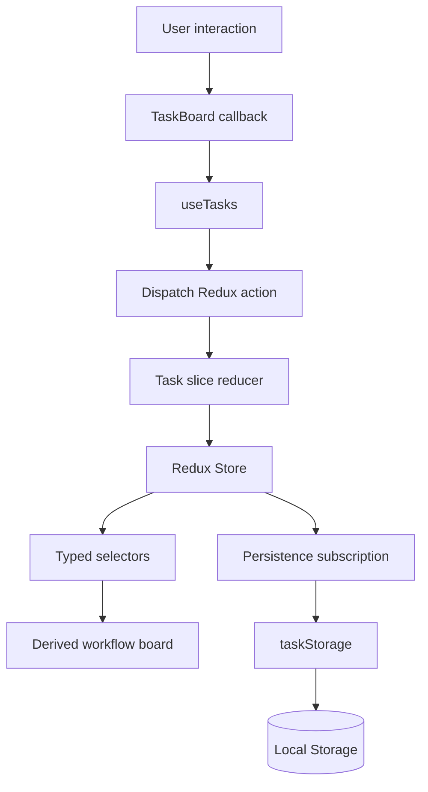

# Team Workflow Board

A responsive task-management application built with React, TypeScript, Vite, Tailwind CSS, Redux Toolkit, and React DnD.

The application provides centralized task state management, a three-column workflow board, drag-and-drop interactions, reusable UI components, advanced filtering and sorting, and versioned browser storage.

Built as part of the Everquint frontend technical assessment.

## Features

- **Workflow board:** Organize tasks into Backlog, In Progress, and Done.
- **Task management:** Create and edit tasks with title, description, status, priority, assignee, and tags.
- **Centralized state management:** Manage shared task state using Redux Toolkit.
- **Drag-and-drop:** Move tasks between workflow columns using React DnD.
- **Accessible status updates:** Change task status using a keyboard-operable dropdown.
- **Search and filters:** Search titles and descriptions; filter by multiple statuses and priority.
- **Sorting:** Sort tasks by creation date, update date, or priority.
- **URL synchronization:** Preserve filter and sorting selections in the query string.
- **Persistence:** Save tasks to localStorage using a versioned schema.
- **Data migration:** Upgrade supported older storage data to the current format.
- **Error handling:** Protect corrupted or unsupported stored data from being overwritten.
- **User feedback:** Display validation errors, storage warnings, migration notices, and toast notifications.
- **Reusable design system:** Button, TextInput, TextArea, Select, Badge, Card, Modal, and Toast.
- **Responsive layout:** Support narrow and wide screen sizes.

## Centralized State Management

Redux Toolkit provides the single source of truth for persistent task state.

The Redux implementation includes:

- A configured Redux store with TypeScript support.
- A task slice containing task reducers and generated action creators.
- Typed Redux dispatch, selector, and store hooks.
- Selectors that encapsulate the Redux state structure.
- Prepare callbacks for generating task IDs and timestamps outside reducers.
- Immer-powered immutable state updates.
- A store subscription for browser persistence.
- Redux DevTools integration for inspecting actions and state transitions.
- Independent store instances for automated testing.

Temporary UI state, including modal visibility, editing selection, and form inputs, remains local to React.

Filter and sorting state is managed separately through a custom hook with URL synchronization.

## Drag-and-Drop Task Management

- Move tasks between Backlog, In Progress, and Done using React DnD.
- Dedicated drag handles prevent interference with card controls.
- Visual feedback identifies valid drop destinations.
- Dragged cards become partially transparent during movement.
- Same-column drops are rejected to prevent redundant updates.
- Cancelled drag operations preserve the original task state.
- Successful drops dispatch Redux actions that update task status and modification timestamps.
- Column counts and visible task positions are derived from the updated state.
- Task changes are automatically persisted to localStorage.
- Success toast notifications provide immediate feedback.
- Status dropdowns remain available as an accessible alternative for keyboard and touch-device users.
- Active search, filtering, and sorting rules remain respected.

Both drag-and-drop and dropdown interactions use the same centralized status-update pathway.

## Technology Stack

| Technology | Purpose |
|---|---|
| React | Component-based user interface |
| TypeScript | Static typing and type safety |
| Vite | Development server and production bundling |
| Tailwind CSS | Responsive styling |
| Redux Toolkit | Centralized state management |
| React Redux | React integration with Redux |
| React DnD | Drag-and-drop interactions |
| React DnD HTML5 Backend | Native desktop browser drag events |
| Lucide React | Interface icons |
| Vitest | Automated testing |
| React Testing Library | Component and integration testing |
| React DnD Test Backend | Programmatic drag-and-drop testing |
| jsdom | Browser-like testing environment |
| Browser localStorage | Versioned client-side persistence |
| ESLint | Static code analysis |

## Getting Started

### Prerequisites

Install a Node.js version compatible with the project's dependencies and a supported npm version.

### Installation

From the assessment repository root:

```bash
cd frontend/team-workflow-board
npm ci
```

If the frontend is checked out as a standalone project, run `npm ci` directly from the project directory.

### Start the development server

```bash
npm run dev
```

Open the local URL displayed in the terminal.

### Run automated tests

```bash
npm run test:run
```

The automated suite contains 50 passing tests across six test files.

### Run lint checks

```bash
npm run lint
```

### Run TypeScript checks

```bash
npm run typecheck
```

### Build for production

```bash
npm run build
```

### Preview the production build

```bash
npm run preview
```

## Project Structure

```text
src/
├── components/
│   └── ui/
│       ├── Button/
│       ├── TextInput/
│       ├── TextArea/
│       ├── Select/
│       ├── Badge/
│       ├── Card/
│       ├── Modal/
│       └── Toast/
├── data/
│   └── initialTasks.ts
├── features/
│   └── tasks/
│       ├── components/
│       │   ├── TaskBoard.tsx
│       │   ├── TaskCard.tsx
│       │   ├── TaskColumn.tsx
│       │   ├── TaskForm.tsx
│       │   ├── TaskFiltersBar.tsx
│       │   ├── TaskBoard.test.tsx
│       │   └── TaskDnd.test.tsx
│       ├── types/
│       │   └── taskDnd.ts
│       ├── taskSlice.ts
│       ├── taskSlice.test.ts
│       ├── taskSelectors.ts
│       └── taskSelectors.test.ts
├── hooks/
│   ├── useTasks.ts
│   └── useTaskFilters.ts
├── store/
│   ├── store.ts
│   ├── appStore.ts
│   ├── hooks.ts
│   ├── taskPersistence.ts
│   └── taskPersistence.test.ts
├── test/
│   └── renderWithDnd.tsx
├── types/
│   ├── task.ts
│   └── filters.ts
├── utils/
│   ├── taskStorage.ts
│   └── taskStorage.test.ts
└── App.tsx
```

The tree highlights the principal application and testing modules.

## Architecture Overview

The application separates presentation, centralized state management, transient UI interactions, derived filter state, and browser persistence.

- `App` provides the Redux and React DnD contexts.
- `TaskBoard` coordinates the board UI, dialogs, notifications, and task interactions.
- `TaskColumn` renders workflow columns and registers drop targets.
- `TaskCard` renders task details, controls, and drag sources.
- `useTasks` provides a stable interface between React components and Redux through typed selectors and dispatch-backed callbacks.
- `taskSlice.ts` defines task state, reducers, and action creators.
- `taskSelectors.ts` encapsulates access to Redux state.
- `store.ts` provides the store factory and inferred TypeScript types.
- `appStore.ts` creates the application store and initializes persistence.
- `taskPersistence.ts` synchronizes task changes with browser storage.
- `useTaskFilters` manages filter state and URL synchronization.
- `taskStorage.ts` handles storage validation, serialization, and migration.
- Shared UI components provide consistent styling and interaction patterns.

Redux Toolkit was selected to provide predictable centralized state management, immutable updates, testable reducers, and clear separation between state transitions and side effects.

### Data Flow



See [ARCHITECTURE.md](./ARCHITECTURE.md) for further details.

## Browser Persistence

Task data is stored under the following localStorage key:

```text
everquint-workflow-tasks
```

The current storage schema version is `2`.

The persistence implementation supports:

- Loading default tasks when saved data is absent.
- Restoring valid saved tasks.
- Preserving intentionally empty task collections.
- Migrating supported version 1 data to version 2.
- Displaying migration notices.
- Handling malformed JSON and unsupported schema versions.
- Preventing automatic overwrites after an initial storage read failure.
- Reporting storage write failures without discarding in-memory task state.
- Retrying persistence on subsequent task modifications.
- Avoiding unnecessary storage writes when task data has not changed.

Browser storage is scoped to the application origin and does not provide cross-device synchronization.

## Testing

The automated test suite contains 50 passing tests across six test files.

| Test Suite | Tests |
|---|---:|
| TaskBoard functionality | 4 |
| Storage validation and migration | 4 |
| Drag-and-drop integration | 12 |
| Redux task reducers | 12 |
| Redux selectors | 5 |
| Redux store and persistence | 13 |
| **Total** | **50** |

### TaskBoard Tests

- Creating a task and displaying it in Backlog.
- Moving a task between workflow statuses.
- Filtering tasks by title.
- Rejecting an empty task title.

### Storage Tests

- Migrating version 1 task data to version 2.
- Handling corrupted stored JSON.
- Preserving an empty saved task list.
- Rejecting unsupported storage schema versions.

### Drag-and-Drop Tests

Coverage includes valid workflow transitions, invalid drops, cancelled drag operations, visual feedback, notifications, column counts, and persistence across remounts.

### Redux Reducer Tests

Coverage includes:

- Initial state.
- Task creation and insertion order.
- Task editing.
- Status transitions.
- Timestamp handling.
- Nonexistent task handling.
- Redundant status updates.
- State immutability.
- Preservation of unchanged task references.
- Migration notice dismissal.
- Storage error updates.

### Redux Selector Tests

Coverage includes task selection, storage errors, migration notices, persistence eligibility, and reference stability.

### Redux Store and Persistence Tests

Coverage includes store initialization, independent store instances, initial persistence, task creation, status updates, unnecessary write prevention, migration, corrupted-data protection, storage failure recovery, and subscription cleanup.

### Manual Verification

Manual browser checks cover:

- Task creation and editing.
- Drag-and-drop and dropdown status changes.
- Search, filtering, and sorting.
- Modal and keyboard interactions.
- Toast notifications.
- Browser persistence after refresh.
- Redux DevTools action inspection.

### Verification Results

The final Redux integration verification produced:

| Check | Result |
|---|---|
| ESLint | Passed |
| TypeScript | Passed |
| Automated test files | 6/6 passed |
| Automated tests | 50/50 passed |
| Production build | Passed |
| Redux DevTools verification | Passed |
| Manual regression testing | Passed |

## Performance

React DevTools Profiler was used during development to inspect TaskCard rendering during status changes.

The implementation uses:

- `React.memo` for TaskCard.
- `useCallback` for stable event-handler references.
- `useMemo` for filtering and sorting.
- Immer-powered immutable state updates.
- Structural sharing that preserves unchanged task object references.
- Selective Redux subscriptions.
- Reference-based checks to avoid unnecessary browser storage writes.

During earlier profiling, a selected single-task update showed only the affected TaskCard rendering, while the other two cards were absent from that render.

The Redux reducer tests additionally verify that unchanged task objects retain their references.

No overall speedup percentage is claimed because repeated, directly comparable timing measurements were not collected.

## Accessibility

- Workflow columns expose accessible names.
- Task status dropdowns provide a keyboard-operable alternative to dragging.
- Dedicated drag handles avoid interfering with other task controls.
- Modal and form interactions support keyboard usage.
- Validation errors, notifications, and storage warnings communicate application outcomes.
- Responsive layouts support different screen sizes.

The application does not claim comprehensive accessibility compliance or dedicated keyboard drag-and-drop support.

## Known Limitations and Trade-offs

- Data is stored locally in the browser without account synchronization or a backend.
- The HTML5 drag-and-drop backend is intended primarily for desktop pointer interactions.
- Dedicated touch and keyboard dragging are not implemented; the status dropdown remains available as an alternative.
- Manual task ordering within columns is not supported because sorting rules remain authoritative.
- Browser storage can be cleared, corrupted, or unavailable.
- Unsaved in-memory changes can be lost if the browser is refreshed before persistence recovers.
- The initial dataset is intended for demonstration rather than production-scale usage.
- The application uses a native confirmation dialog for unsaved form changes.
- The board is not virtualized for very large task collections.
- The automated test suite covers selected critical flows rather than every possible UI interaction.

## Future Improvements

Potential enhancements include:

- Backend persistence and authenticated user accounts.
- Multi-user collaboration and cross-device synchronization.
- Dedicated touch and keyboard drag-and-drop support.
- Explicit manual ordering rules.
- Task import and export.
- Additional accessibility testing.
- Browser end-to-end testing.
- Virtualized rendering for large task collections.
